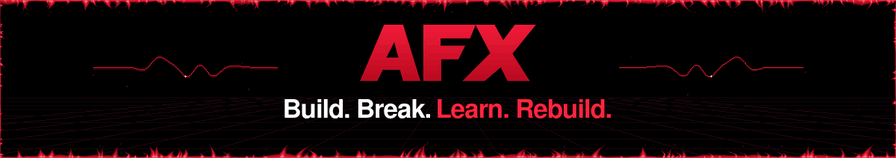

<table role="presentation">
<tr><td colspan="3">
<picture><source media="(prefers-reduced-motion: reduce)" srcset="./assets/flames/top-still.png"></picture>
</td></tr>
<tr>
<td height="1" valign="top">
<table height="100%"><tr><td nowrap valign="top">
<picture><source media="(prefers-reduced-motion: reduce)" srcset="./assets/flames/left-still.png"></picture> 
<picture><source media="(prefers-reduced-motion: reduce)" srcset="./assets/flames/left-still.png"></picture> 
<picture><source media="(prefers-reduced-motion: reduce)" srcset="./assets/flames/left-still.png"></picture> 
<picture><source media="(prefers-reduced-motion: reduce)" srcset="./assets/flames/left-still.png"></picture> 
<picture><source media="(prefers-reduced-motion: reduce)" srcset="./assets/flames/left-still.png"></picture> 
<picture><source media="(prefers-reduced-motion: reduce)" srcset="./assets/flames/left-still.png"></picture> 
<picture><source media="(prefers-reduced-motion: reduce)" srcset="./assets/flames/left-still.png"></picture> 
<picture><source media="(prefers-reduced-motion: reduce)" srcset="./assets/flames/left-still.png"></picture> 
<picture><source media="(prefers-reduced-motion: reduce)" srcset="./assets/flames/left-still.png"></picture> 
<picture><source media="(prefers-reduced-motion: reduce)" srcset="./assets/flames/left-still.png"></picture> &emsp;&emsp;&emsp;
</td></tr></table>
</td>
<td valign="top">

# Shaik Arfan

<picture>
  <source media="(prefers-reduced-motion: reduce)" srcset="./assets/afx-scarlet-hero-still.png">
  <source type="image/webp" srcset="./assets/afx-scarlet-hero.webp">
  
</picture>

I build developer tools for inspecting APIs, testing regular expressions, and tracking down problems in logs. Under **AFX**, I also work on Windows utilities and experiment with LLMs, retrieval-augmented generation, and AI-powered interfaces.

## Contribution activity

## Featured AFX projects

- [**AFX Regex Tester**](https://github.com/arfanshaik/AFX-Regex-Tester) · JavaScript  
  Live regex playground with matches, groups, replacements, presets and history
- [**AFX API Inspector**](https://github.com/arfanshaik/AFX-API-Inspector) · TypeScript  
  Developer-focused API inspection and testing utility
- [**AFX LogWatch**](https://github.com/arfanshaik/AFX-LogWatch) · Go  
  Lightweight log monitoring utility
- [**AFX PC Optimizer**](https://github.com/arfanshaik/AFX-PC-Optimizer) · System Tools  
  PC optimization and system utility project
- [**AFX Driver Checker**](https://github.com/arfanshaik/AFX-Driver-Checker) · System Tools  
  Driver-checking utility for Windows systems
- [**AFX Gaming Mode**](https://github.com/arfanshaik/AFX-Gaming-Mode) · System Tools  
  Gaming-focused PC performance utility

## Tools I use

**Languages** · Python, JavaScript, TypeScript, C++, HTML, CSS

**Frontend and design** · React, Figma

**Development** · Git, GitHub, VS Code

GitHub stats, streak, and trophies

### Trophies

### Contribution trend

> **ARFAN — ENCRYPTION IS NOT A CRIME**  
> `CODE. BUILD. EVOLVE.`  
> *Build. Break. Learn. Rebuild.*

[Browse all my repositories →](https://github.com/arfanshaik?tab=repositories)

<picture>
  <source media="(prefers-reduced-motion: reduce)" srcset="./assets/afx-scarlet-finale-still.png">
  
</picture>

</td>
<td height="1" valign="top">
<table height="100%"><tr><td nowrap valign="top">
<picture><source media="(prefers-reduced-motion: reduce)" srcset="./assets/flames/right-still.png"></picture> 
<picture><source media="(prefers-reduced-motion: reduce)" srcset="./assets/flames/right-still.png"></picture> 
<picture><source media="(prefers-reduced-motion: reduce)" srcset="./assets/flames/right-still.png"></picture> 
<picture><source media="(prefers-reduced-motion: reduce)" srcset="./assets/flames/right-still.png"></picture> 
<picture><source media="(prefers-reduced-motion: reduce)" srcset="./assets/flames/right-still.png"></picture> 
<picture><source media="(prefers-reduced-motion: reduce)" srcset="./assets/flames/right-still.png"></picture> 
<picture><source media="(prefers-reduced-motion: reduce)" srcset="./assets/flames/right-still.png"></picture> 
<picture><source media="(prefers-reduced-motion: reduce)" srcset="./assets/flames/right-still.png"></picture> 
<picture><source media="(prefers-reduced-motion: reduce)" srcset="./assets/flames/right-still.png"></picture> 
<picture><source media="(prefers-reduced-motion: reduce)" srcset="./assets/flames/right-still.png"></picture> &emsp;&emsp;&emsp;
</td></tr></table>
</td>
</tr>
<tr><td colspan="3">
<picture><source media="(prefers-reduced-motion: reduce)" srcset="./assets/flames/bottom-still.png"></picture>
</td></tr>
</table>
