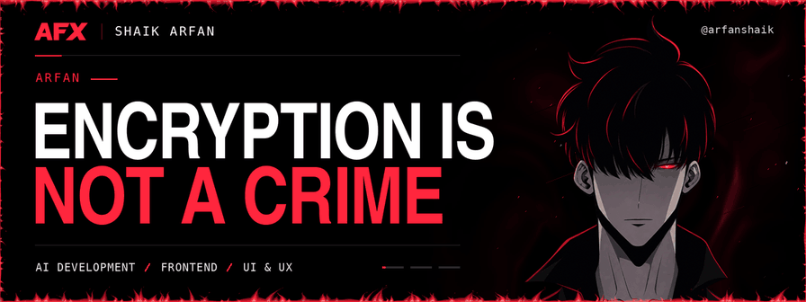
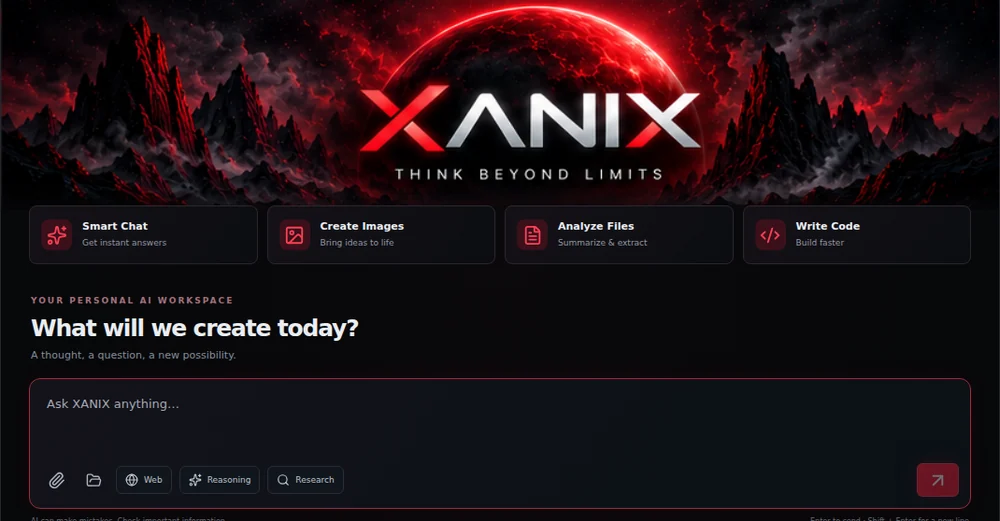
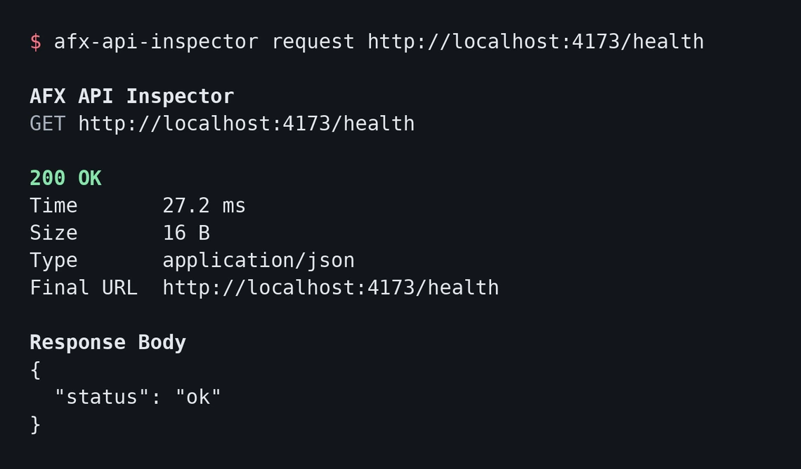
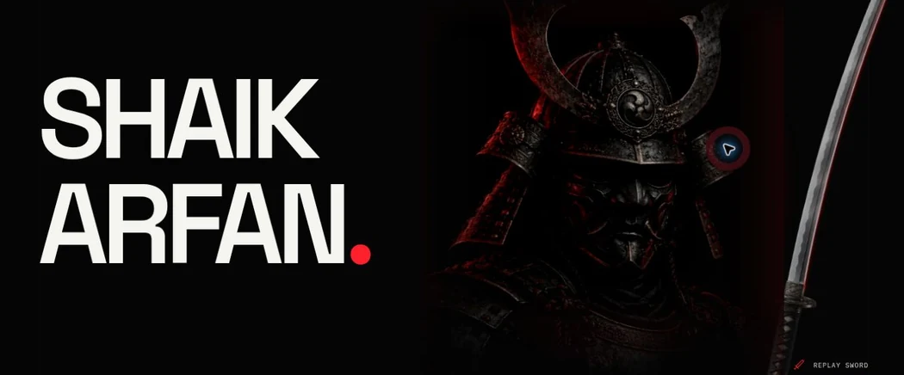

# Shaik Arfan

I’m a B.Tech student in Visakhapatnam, India. Under the name **AFX**, I build AI interfaces, developer tools and Windows utilities. I’m open to internships and collaborations.

[Visit my portfolio](https://shaikarfandev.netlify.app/) · [Browse my repositories](https://github.com/arfanshaik?tab=repositories)

<a href="https://shaikarfandev.netlify.app/">
  <picture>
    <source media="(prefers-reduced-motion: reduce)" srcset="https://raw.githubusercontent.com/arfanshaik/arfanshaik/main/assets/afx-scarlet-hero-still.png">
    <source type="image/webp" srcset="https://raw.githubusercontent.com/arfanshaik/arfanshaik/main/assets/afx-scarlet-hero.webp">
    
  </picture>
</a>

## Skills and languages

- **Programming languages** · Python, JavaScript, TypeScript, Go and C++
- **Web development** · HTML, CSS, React, Vite, Node.js and FastAPI
- **Design and workflow** · Figma for wireframes and prototypes, Git for version control and GitHub Actions for automated tests

I’m learning how retrieval-augmented generation (RAG) can ground an AI assistant’s replies in the documents it retrieves.

## Selected work

### [XANIX](https://github.com/arfanshaik/AFX-AI-LLM)

I connected a React and TypeScript chat interface to a Python backend built with FastAPI. You can attach a document, stream a reply from your model provider and return to the saved conversation.

<a href="https://github.com/arfanshaik/AFX-AI-LLM">
  <picture>
    <source media="(max-width: 600px)" srcset="https://raw.githubusercontent.com/arfanshaik/arfanshaik/main/assets/projects/xanix-mobile.webp">
    
  </picture>
</a>

### [AFX API Inspector](https://github.com/arfanshaik/AFX-API-Inspector)

I built a TypeScript command-line tool for inspecting HTTP responses. It shows the status, headers and body, measures response times and can rerun a saved collection of requests. Here it is reading a local health endpoint.

<a href="https://github.com/arfanshaik/AFX-API-Inspector">
  <picture>
    <source media="(max-width: 600px)" srcset="https://raw.githubusercontent.com/arfanshaik/arfanshaik/main/assets/projects/api-inspector-mobile.webp">
    
  </picture>
</a>

### [AFX Portfolio](https://github.com/arfanshaik/AFX-portfolio-)

I designed and built my portfolio in Next.js. The opening portrait reveals a samurai with a pointer, tap or keyboard input, and each project has its own case study.

### More projects

- [AFX PC Intelligence](https://github.com/arfanshaik/AFX-PC-Intelligence) · For a college hackathon, I built a PC planner that suggests parts for a budget in rupees and checks their compatibility.
- [AFX Regex Tester](https://github.com/arfanshaik/AFX-Regex-Tester) · A browser playground for highlighting matches, inspecting capture groups and previewing replacements as you type.
- [AFX LogWatch](https://github.com/arfanshaik/AFX-LogWatch) · A Go tool for following log files, filtering events by severity and exporting matches as JSON Lines.
- **Windows utilities** · [PC Optimizer](https://github.com/arfanshaik/AFX-PC-Optimizer), [Driver Checker](https://github.com/arfanshaik/AFX-Driver-Checker) and [Gaming Mode](https://github.com/arfanshaik/AFX-Gaming-Mode)

GitHub contribution activity

<a href="https://shaikarfandev.netlify.app/">
  <picture>
    <source media="(prefers-reduced-motion: reduce)" srcset="https://raw.githubusercontent.com/arfanshaik/arfanshaik/main/assets/afx-scarlet-finale-still.png">
    
  </picture>
</a>
