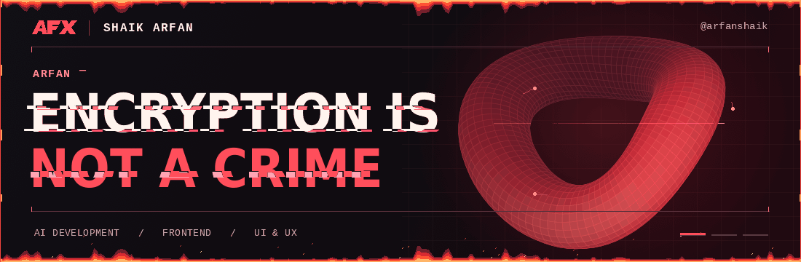
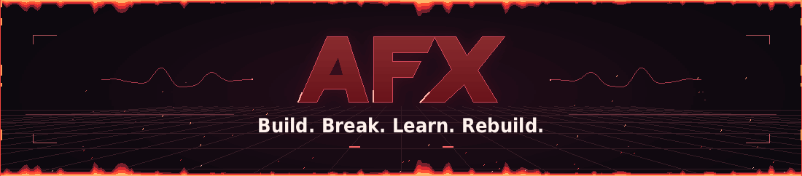

# Shaik Arfan

<picture>
  <source media="(prefers-reduced-motion: reduce)" srcset="./assets/afx-still.png">
  
</picture>

I build developer tools for inspecting APIs, testing regular expressions, and tracking down problems in logs. Under **AFX**, I also work on Windows utilities and experiment with LLMs, retrieval-augmented generation, and AI-powered interfaces.

## Contribution activity

## Featured AFX projects

| Project | What it does | Tech |
|---|---|---|
| [**AFX Regex Tester**](https://github.com/arfanshaik/AFX-Regex-Tester) | Live regex playground with matches, groups, replacements, presets and history | JavaScript |
| [**AFX API Inspector**](https://github.com/arfanshaik/AFX-API-Inspector) | Developer-focused API inspection and testing utility | TypeScript |
| [**AFX LogWatch**](https://github.com/arfanshaik/AFX-LogWatch) | Lightweight log monitoring utility | Go |
| [**AFX PC Optimizer**](https://github.com/arfanshaik/AFX-PC-Optimizer) | PC optimization and system utility project | System Tools |
| [**AFX Driver Checker**](https://github.com/arfanshaik/AFX-Driver-Checker) | Driver-checking utility for Windows systems | System Tools |
| [**AFX Gaming Mode**](https://github.com/arfanshaik/AFX-Gaming-Mode) | Gaming-focused PC performance utility | System Tools |

## Tools I use

**Languages** · Python, JavaScript, TypeScript, C++, HTML, CSS

**Frontend and design** · React, Figma

**Development** · Git, GitHub, VS Code

GitHub stats, streak, and trophies

### Trophies

### Contribution trend

> **ARFAN — ENCRYPTION IS NOT A CRIME**  
> `CODE. BUILD. EVOLVE.`  
> *Build. Break. Learn. Rebuild.*

[Browse all my repositories →](https://github.com/arfanshaik?tab=repositories)

<picture>
  <source media="(prefers-reduced-motion: reduce)" srcset="./assets/afx-finale-still.png">
  
</picture>
